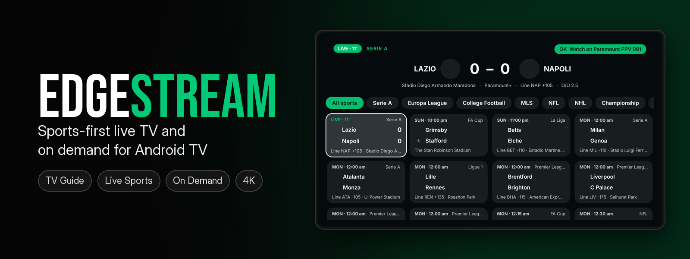
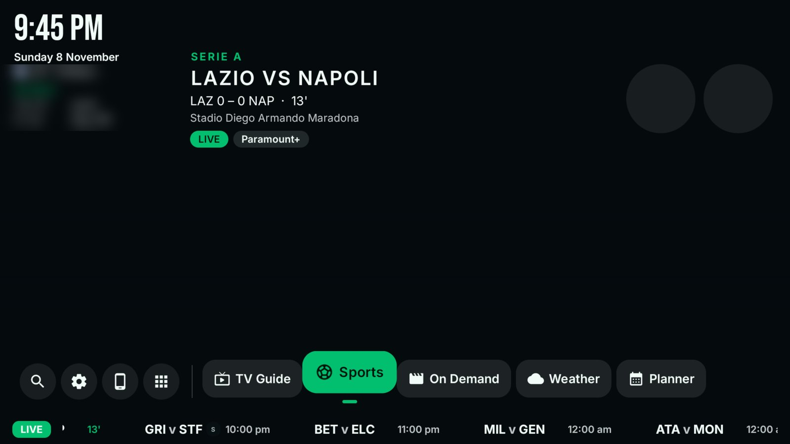
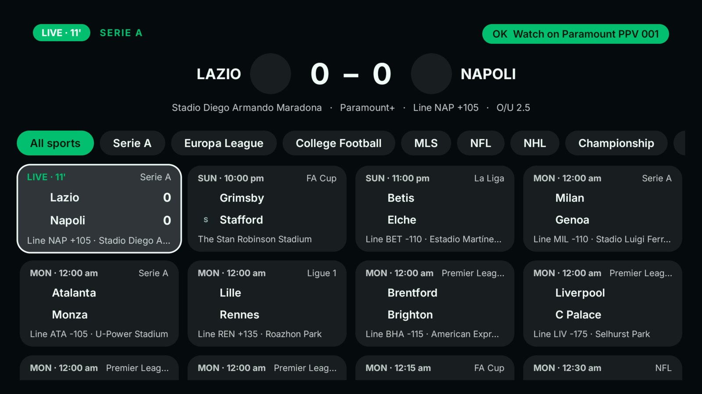
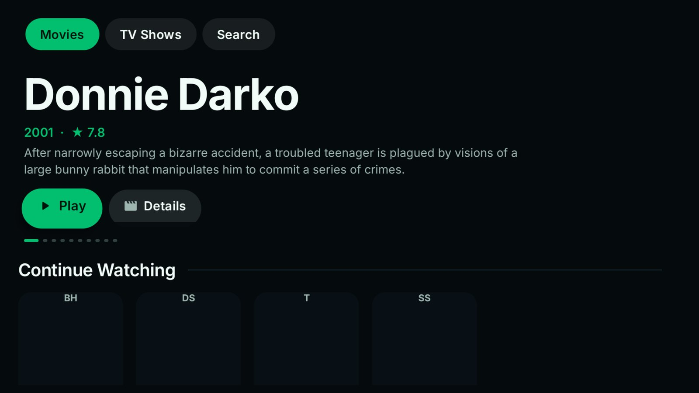
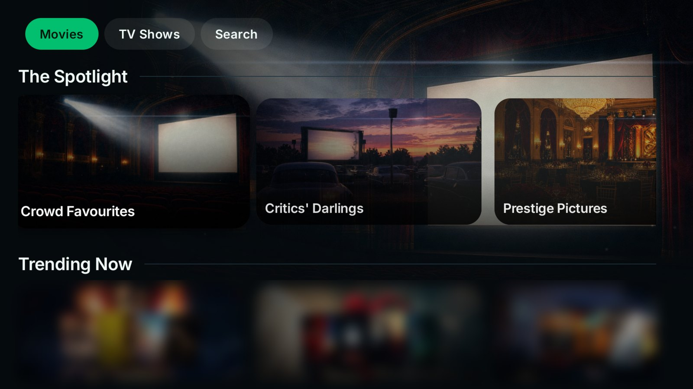
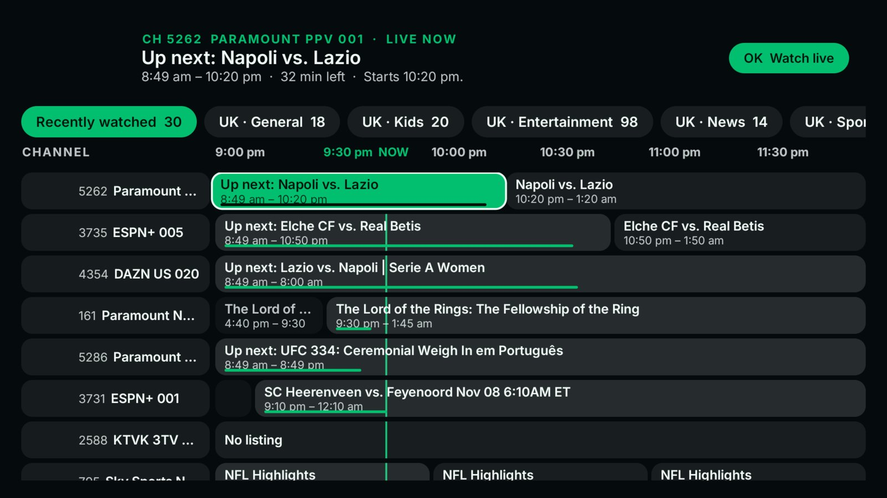
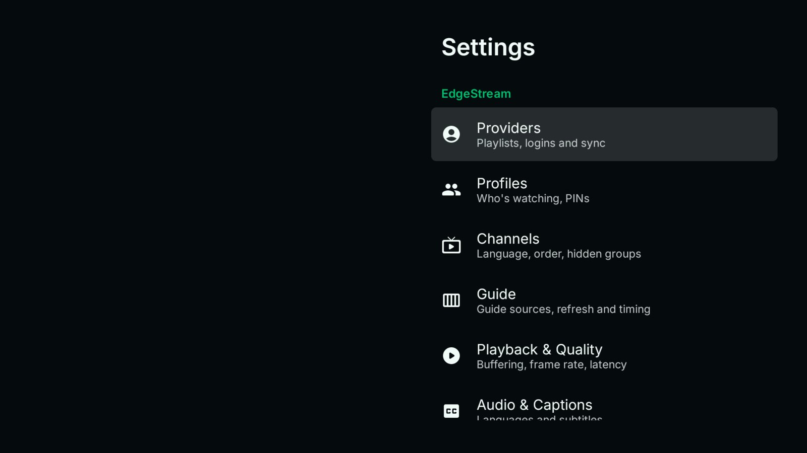
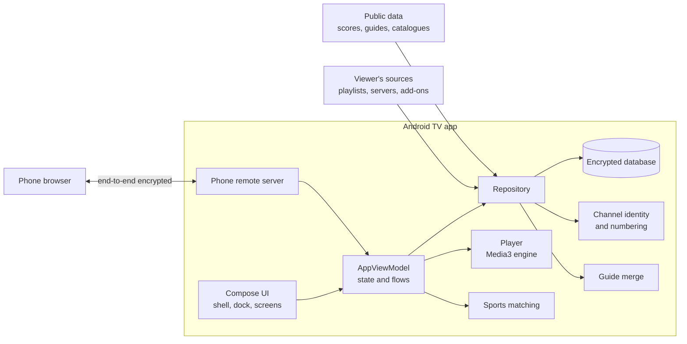

<p align="center">
  
</p>

<p align="center">
  <a href="https://github.com/EDGEL00P/edgestream/actions/workflows/ci.yml"></a>
  
  
  
  
</p>

<p align="center"><a href="https://edgel00p.github.io/edgestream/"><b>edgel00p.github.io/edgestream</b></a></p>

**EdgeStream** is a sports-first TV app for the living room: live channels with a real TV guide,
every game matched to the channel showing it, and an on-demand library, all driven by a remote
control on a 4K screen. Everything runs on the TV itself: no backend, no account, no server.

## Screens

<table>
  <tr>
    <td width="50%"><br><sub><b>Home</b>: clock, planner, the game coming up and the dock</sub></td>
    <td width="50%"><br><sub><b>Sports</b>: every game, and the channel carrying it</sub></td>
  </tr>
  <tr>
    <td><br><sub><b>On Demand</b>: full-screen artwork and Continue Watching</sub></td>
    <td><br><sub><b>Collections</b>: curated folders with their own cover art</sub></td>
  </tr>
  <tr>
    <td><br><sub><b>TV Guide</b>: your channels, numbered and listed like real TV</sub></td>
    <td><br><sub><b>Settings</b>: one list, the way TV system settings read</sub></td>
  </tr>
</table>

## Features

### TV Guide

- Playlist and portal logins, with channel numbers that follow real broadcast numbering per
  country: enter `101` on the remote for BBC One HD.
- Channel identity: every channel is resolved once to its real name, logo, category and country.
  Names that could mean two channels are left unresolved, never guessed.
- A guide merged from several sources, with catch-up where the provider offers it.

### Sports

- Live scores, fixtures, standings and odds for 40+ leagues.
- Every game finds its channel in the lineup: a saved pick, then an event channel for that exact
  match (time and competition checked), then the guide, then the listed broadcaster.
- Racing cards, and two live streams side by side.

### On Demand

- Curated collections with their own artwork, defined remotely and editable without an update.
- Plays from the viewer's own sources: a home media server, the provider's library (looked up
  when played, never downloaded) and stream add-ons, in that order.
- Continue Watching, My List, Up Next with a timed autoplay, online subtitles, stream quality
  badges and watch tracking.

### Around the house

- Weather and storm radar, and a planner with reminders.
- A phone remote over the home network: D-pad, typing, voice commands and questions such as
  *"what's on Fox League?"* or *"when do the Broncos play?"*
- Move the whole setup from one TV to another with a six-digit code.

## Architecture



## Security

| Area | Protection |
| ---- | ---------- |
| Data at rest | Whole-database encryption; the key is held by the Android Keystore |
| Logins and settings | Each typed secret is sealed with a Keystore key |
| Phone remote | End-to-end encryption with a key carried only in the pairing QR code; replayed requests rejected |
| TV-to-TV transfer | Key agreement bound to a code shown on the receiving TV; five wrong codes end it |

See [SECURITY.md](SECURITY.md) to report a vulnerability privately.

## Build and test

Requirements: JDK 17, the Android SDK, and an Android TV device running Android 7.0 (API 24) or later.

```powershell
.\gradlew.bat :app:assembleDebug :app:testDebugUnitTest --console=plain
```

Debug builds are split per ABI under `app/build/outputs/apk/debug/`: `app-arm64-v8a-debug.apk`
for 64-bit devices and `app-armeabi-v7a-debug.apk` for 32-bit ones. Install over the network:

```powershell
$adb = "$env:LOCALAPPDATA\Android\Sdk\platform-tools\adb.exe"
& $adb connect <tv-ip>:5555
& $adb -s <tv-ip>:5555 install -r app\build\outputs\apk\debug\app-arm64-v8a-debug.apk
```

## Project layout

| Path | What it holds |
| ---- | ------------- |
| `app/src/main/java/com/edgestream/tv/data` | Sources, guide, sports, catalogues, channel identity, encryption |
| `app/src/main/java/com/edgestream/tv/player` | Playback engine, buffering, subtitles, captions |
| `app/src/main/java/com/edgestream/tv/remote` | Phone remote server, voice commands, setup transfer |
| `app/src/main/java/com/edgestream/tv/ui` | Shell, dock, screens, components, themes |
| `app/src/main/assets` | Prebuilt guide map, channel catalogue, phone remote page |
| `app/src/test` | Unit tests |
| `site/` | The product website, published to GitHub Pages |
| `tools/` | Guide-map and channel-catalogue builders, device test scripts |

EdgeStream ships no channels, films or series: the viewer supplies every source.

## License

Copyright © 2026 EDGEL00P. All rights reserved. No license is granted to use, copy, modify or
distribute this software.
